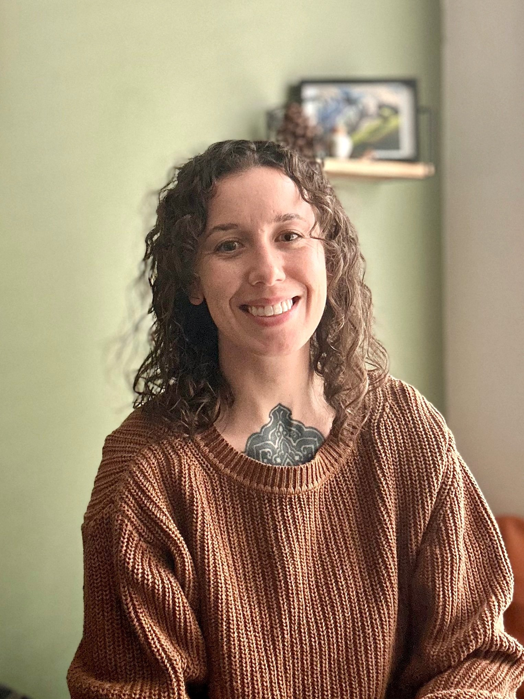

# Page: About

**URL:** <https://www.watersedgemassage.com/about>
**Title tag:** Water's Edge Massage Therapy | RMT in North Vancouver
**Meta description:** Alexis Penner is a Registered Massage Therapist with over 10 years of experience.

## Heading outline (as on the live page)

- H2: About Alexis
- H1: Have Questions or Want to Book a Massage?

## Links in page body

_(none)_

---

## Page content (verbatim, converted to Markdown)

> Note: Squarespace headings are kept at their original levels below (the live site uses H1/H2/H4).
> Shared header navigation and footer are documented in `content/_site-chrome.md`.

## About Alexis

Since 2015, Alexis has been a dedicated Registered Massage Therapist, blending scientific knowledge with an intuitive and compassionate approach to deliver personalized, therapeutic care. She recognizes the deep connection between physical and mental well-being and creates a safe, supportive space for healing.

Believing that every person is unique, Alexis tailors each treatment to individual needs, emphasizing patient education and self-awareness as key components of recovery. She has an innate ability to meet people where they are, allowing her to connect with authenticity and adapt her treatments to support each person’s goals, comfort, and capacity. Alexis remains committed to ongoing learning, with a focus on holistic and evidence-informed approaches that empower lasting change.

Her passion for healing is deeply personal, shaped by her own experiences recovering from injuries, including a serious car accident and the physical demands of an active lifestyle. Through manual therapy, home care, and strength training, she helps patients move toward their most functional, pain-free selves.

Outside the clinic, Alexis finds balance in nature with trail running, gravel and mountain biking, and spending time with her dog. North Vancouver’s natural beauty and active lifestyle inspire her daily, and she is grateful to call it home.

# Have Questions or Want to Book a Massage?

I’d love to hear from you. Feel free to reach out using the form below or email me directly. I’ll get back to you within 1–2 business days.

Looking forward to connecting,
 **Alexis**
 *Registered Massage Therapist*

> **[Contact form]** (Squarespace form "About Form 2")
>
> - **Name** (name, required)
> - **Email** (email, required, mailing-list opt-in)
> - **Message** (textarea, required)
>
> Submit button: "Submit" · Success message: "Thank you!"
