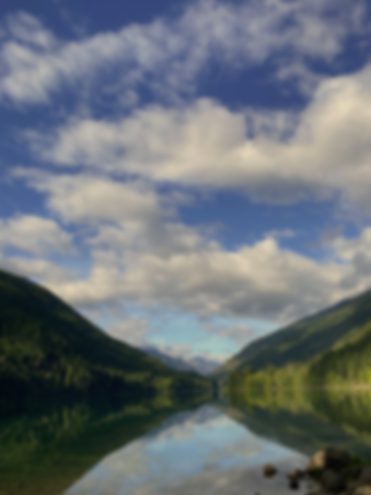

# Page: Contact

**URL:** <https://www.watersedgemassage.com/contact>
**Title tag:** Water's Edge Massage Therapy | RMT in North Vancouver
**Meta description:** _(none set)_

## Heading outline (as on the live page)

- H1: Have Questions?

## Links in page body

- [alexispenner.rmt@gmail.com](mailto:alexispenner.rmt@gmail.com?)

---

## Page content (verbatim, converted to Markdown)

> Note: Squarespace headings are kept at their original levels below (the live site uses H1/H2/H4).
> Shared header navigation and footer are documented in `content/_site-chrome.md`.

# Have Questions?

We are located at the Harbour Quay Building on the 5th floor- 224 West Esplanade.

Guest parking is behind the building in Stalls #13 and #14 only.

Street parking along Esplanade, Semisch, Chesterfield as well as 1st and 2nd St.

Paid parking under Sailor Hagars Pub.

[alexispenner.rmt@gmail.com](mailto:alexispenner.rmt@gmail.com?)
(604) 754-4886 Text Only

> **[Embedded map]** Water's Edge Massage Therapy — 500-224 Esplanade West, North Vancouver, BC, V7M 3H8 Canada (lat 49.3131151, lng -123.0834664, zoom 12)

> **[Contact form]** (Squarespace form "New Form 2 3")
>
> - **Name** (name, required)
> - **Email** (email, required)
> - **Message** (textarea, required)
>
> Submit button: "SEND" · Success message: "Thank you!"

